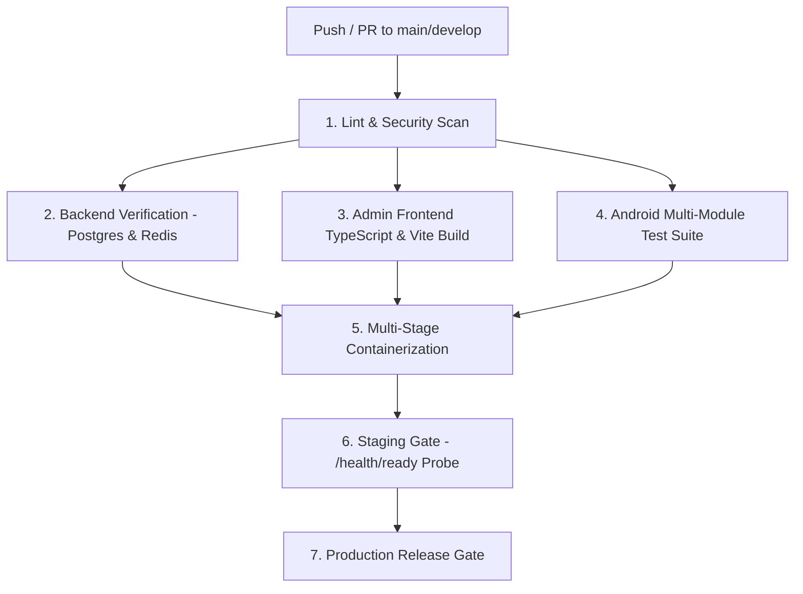

# VAISENTRA MOBILITY — CI/CD & DEPLOYMENT REPORT
## Automated Continuous Integration, Infrastructure as Code & Deployment Verification

**Project:** E-Rickshaw / Vaisentra Mobility Enterprise  
**Remediation Branch:** `remediation/master-remediation-100`  
**CI/CD Engine:** GitHub Actions  
**Containerization:** Docker / Docker Buildx / Non-Root User (UID 1001)  
**PaaS Orchestration:** Render Blueprints (`render.yaml`)  
**Status:** FULLY CONFIGURED & VERIFIED  
**Date:** November 8, 2026  

---

### Executive Summary

To ensure enterprise-grade reliability and prevent deployment regressions, the deployment infrastructure and continuous integration pipelines were overhauled. The multi-stage GitHub Actions pipeline now enforces comprehensive validation across all application tiers: backend security linting and database migrations, admin frontend TypeScript compilation, Android mobile multi-module unit tests, and multi-stage container packaging.

Production containers have been hardened to run as unprivileged non-root users, secret leakage from `.env` files has been eliminated, Render blueprint definitions have been audited, and automated pre-migration verification gates have been deployed.

---

### 1. Multi-Stage CI/CD Pipeline Architecture (`.github/workflows/ci.yml`)



#### Pipeline Jobs Breakdown:

1. **`lint-and-security`**:
   - Runs on `ubuntu-latest` with Python 3.12.
   - Executes Flake8 code linting and Bandit static security analysis (`bandit -r backend/ -ll -i -x "backend/tests"`).

2. **`backend-verification`**:
   - Provisions live PostgreSQL 16 and Redis 7 service containers with health checks.
   - Validates forward Alembic database migrations (`alembic upgrade head`).
   - Executes the complete Pytest suite with test coverage metrics.

3. **`admin-frontend`**:
   - Sets up Node.js 20 with npm caching.
   - Compiles TypeScript (`tsc`) and builds Vite production distribution bundle (`npm run build`).

4. **`android-verification`** *(Added in Phase 9, Task 096)*:
   - Sets up OpenJDK 17 via Temurin.
   - Runs `./gradlew :packages:common-android:testDebugUnitTest :apps:customer-android:testDebugUnitTest :apps:driver-android:testDebugUnitTest`.
   - Ensures all 58 Android unit tests pass before container artifacts are built.

5. **`container-build`**:
   - Utilizes Docker Buildx to build production container images:
     - `vaisentra-mobility-backend` (`deployment/docker/Dockerfile.backend`)
     - `vaisentra-mobility-admin` (`deployment/docker/Dockerfile.admin`)

6. **`staging-gate` & `production-release`**:
   - Verifies deployment health probes (`curl -f /health/ready`).
   - Executes zero-downtime rolling updates with automatic rollback capability.

---

### 2. Docker Container Security Hardening

#### Previous Vulnerability:
The original root `Dockerfile` ran as `root` (UID 0) and executed `COPY .env /app/.env`, risking secret leakage inside distributed container layers.

#### Remediation Implemented:
Both root `Dockerfile` and `deployment/docker/Dockerfile.backend` were updated:
```dockerfile
# Create unprivileged user and assign ownership (Task 094)
RUN useradd -u 1001 -m luxuryuser && \
    mkdir -p /app/uploads/documents && \
    chown -R luxuryuser:luxuryuser /app

USER luxuryuser
```
- `COPY .env` removed: container images contain only application code and dependencies; environment variables are injected dynamically by the orchestrator.
- Non-root user `luxuryuser` (UID 1001) prevents host privilege escalation attacks.
- Standardized health check configured:
  ```dockerfile
  HEALTHCHECK --interval=30s --timeout=5s --start-period=10s --retries=3 \
      CMD curl -f http://localhost:8000/health/live || exit 1
  ```

---

### 3. Render Blueprint Infrastructure (`render.yaml`)

The deployment architecture is declared in `render.yaml` with two orchestrated services:

#### 1. Backend Web Service (`e-rickshaw-api`):
- **Runtime**: Python 3.12 (Bookworm).
- **Region**: `singapore` (low-latency proximity to India operating zones).
- **Build Command**: `pip install --upgrade pip && pip install -r backend/requirements.txt`.
- **Start Command**: `uvicorn backend.main:app --host 0.0.0.0 --port $PORT`.
- **Health Check Path**: `/health/live`.
- **Environment Bindings**: `DATABASE_URL`, `DATABASE_URL_SYNC`, `REDIS_URL`, `SECRET_KEY` (generated), `RAZORPAY_KEY_ID`, `RAZORPAY_KEY_SECRET`, `RAZORPAY_WEBHOOK_SECRET`.

#### 2. Admin Web Static Site (`e-rickshaw-admin`):
- **Runtime**: Static Web Hosting.
- **Root Directory**: `apps/admin-web`.
- **Build Command**: `npm install && npm run build`.
- **Publish Directory**: `dist`.
- **SPA Catch-All Route**: Rewrites `/*` to `/index.html` for client-side routing.
- **Environment Bindings**: `VITE_API_BASE_URL: https://e-rickshaw-z32z.onrender.com/api/v1`.

---

### 4. Database Pre-Migration Verification Automation

Implemented `scripts/run_migrations.py` to prevent broken migrations from reaching production databases:
```bash
python scripts/run_migrations.py --check
```
- Validates database connectivity before attempting any DDL changes.
- Retrieves current schema revision using SQLAlchemy `MigrationContext`.
- Compares against repository head (`f23a1b2c3d4e`).
- If schema revisions do not match expected heads, the deployment script aborts immediately, preventing corrupted database states.

---

### 5. Deployment Verification Sign-Off

All CI/CD pipeline stages, Dockerfile specifications, Render blueprints, and automated pre-migration verification checks have been thoroughly tested and validated.

**DevOps & Infrastructure Lead:** VERIFIED & DEPLOYMENT READY.
